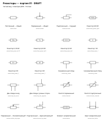
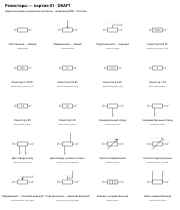

# Resistor review — batch 01 (DRAFT)

Source: [GOST 2.728-74, tables 1 and 6](https://radio-hobby.org/uploads/instruction/other/ugo/gost/gost_2.728-74.pdf). User reference images 01–04 and 08. Original PNG bytes not yet archived; this is not a certified comparison. New artwork uses 10×4 mm body, 45° adjustment marks, two tap spacing 6 mm and offset 2 mm from edge. Mark sizes, lead lengths, layout and protective boxes are project choices. Power is a symbol variant, not a value in ohms. Vertical views of ordinary symbols use transforms; orientation-specific artwork requires separate review. Existing fixed/variable/trimmer definitions are preserved for project-lock compatibility; trimmer current geometry still needs review against reference 03. The remaining user samples are not implemented in this batch.

## Committed JSON-derived vector preview (not a native execution)

The native renderer will independently generate clean and overlay SVG via CI; see artifact resistor-batch01-native. Pin numbers are abstract, not manufacturer pinouts. Orange = body keepout; green = actual contact. No inference of electrical connections from markings.

| ID | Name | Pins |
|---|---|---|
| resistor.fixed | Постоянный — общий | 2 |
| resistor.variable | Переменный — общий | 3 |
| resistor.trimmer | Подстроечный — текущий | 3 |
| resistor.fixed_power_0p05 | Резистор 0,05 Вт | 2 |
| resistor.fixed_power_0p125 | Резистор 0,125 Вт | 2 |
| resistor.fixed_power_0p25 | Резистор 0,25 Вт | 2 |
| resistor.fixed_power_0p5 | Резистор 0,5 Вт | 2 |
| resistor.fixed_power_1 | Резистор 1 Вт | 2 |
| resistor.fixed_power_2 | Резистор 2 Вт | 2 |
| resistor.fixed_power_5 | Резистор 5 Вт | 2 |
| resistor.tap_center | Симметричный отвод | 3 |
| resistor.tap_offset | Несимметричный отвод | 3 |
| resistor.tap_two_same | Два отвода снизу | 4 |
| resistor.tap_two_opposite | Два отвода с разных сторон | 4 |
| resistor.rheostat | Реостат переменный | 2 |
| resistor.trimmer_rheostat | Реостат подстроечный | 2 |
| resistor.variable_side_wiper | Переменный — боковой вывод W | 3 |
| resistor.trimmer_top_wiper | Подстроечный — верхний вывод W | 3 |
| resistor.heater | Элемент нагревательный | 2 |
| resistor.shunt_kelvin | Шунт измерительный | 4 |
