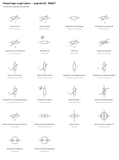
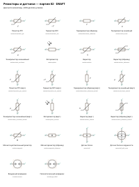

# Batch 02 — DRAFT review

Sources: [GOST 2.728-74 tables 1,6](https://files.stroyinf.ru/Data2/1/4294847/4294847788.pdf), [GOST 2.730-73 tables 9,11](https://files.stroyinf.ru/Data2/1/4294848/4294848038.pdf), [GOST 2.727-68 table 1](https://files.stroyinf.ru/Data2/1/4294833/4294833334.pdf). Scanned graphical tables checked. User images 05–09, 11–12 are visual references, not a normative source. The source PNG bytes have not yet been archived.

Native renderer gallery SVG/PNG: GitHub Actions workflow `Native catalog reference renders`; notes/pin numbers are appended as review text using declared anchors, not certified font outlines. Existing reference-only variants are explicitly identified by their source metadata and remain DRAFT. Vertical examples retain the diagonal direction and upright notes; separate IDs are used for orientation-specific artwork. The 10×4 mm resistor-body profile is retained; lead lengths, marker extents, Hall and arrester dimensions remain editorial. Hall current pins are at short sides of rectangle. The reference circle without a dot is vacuum; gas-filled has the dot. The reactor is deferred pending a real 270° arc primitive; the two uncaptioned objects remain unidentified. Existing fuse retained. No claim of normative certification or full GUI palette integration.

| ID | Title | Pins | Source |
|---|---|---:|---|
| resistor.thermistor_ptc | Позистор PTC | 2 | ГОСТ 2.728-74, табл. 1, поз. 13а; табл. 6, поз. 1 |
| resistor.thermistor_ntc | Термистор NTC | 2 | ГОСТ 2.728-74, табл. 1, поз. 13а; табл. 6, поз. 1 |
| resistor.thermistor_reference | Терморезистор (образец) | 2 | User reference 05; NOT the table 1 item 13a standard shape |
| resistor.strain_linear | Тензорезистор линейный | 2 | ГОСТ 2.728-74, табл. 1, поз. 11; табл. 6, поз. 1 |
| resistor.strain_nonlinear | Тензорезистор нелинейный | 2 | ГОСТ 2.728-74, табл. 1, поз. 11; табл. 6, поз. 1 |
| resistor.photo | Фоторезистор | 2 | ГОСТ 2.730-73, табл. 9, поз. 1а |
| resistor.varistor | Варистор | 2 | ГОСТ 2.728-74, табл. 1, поз. 14 |
| resistor.varistor_reference | Варистор (образец) | 2 | User reference 11; alternative not verified by table 1 item 14 |
| resistor.thermistor_ptc_vertical | Позистор PTC (верт.) | 2 | ГОСТ 2.728-74, табл. 1, поз. 13а; табл. 6, поз. 1 |
| resistor.thermistor_ntc_vertical | Термистор NTC (верт.) | 2 | ГОСТ 2.728-74, табл. 1, поз. 13а; табл. 6, поз. 1 |
| resistor.thermistor_reference_vertical | Терморезистор (образец) (верт.) | 2 | User reference 05; NOT the table 1 item 13a standard shape |
| resistor.strain_linear_vertical | Тензорезистор линейный (верт.) | 2 | ГОСТ 2.728-74, табл. 1, поз. 11; табл. 6, поз. 1 |
| resistor.strain_nonlinear_vertical | Тензорезистор нелинейный (верт.) | 2 | ГОСТ 2.728-74, табл. 1, поз. 11; табл. 6, поз. 1 |
| resistor.photo_vertical | Фоторезистор (верт.) | 2 | ГОСТ 2.730-73, табл. 9, поз. 1а |
| resistor.varistor_vertical | Варистор (верт.) | 2 | ГОСТ 2.728-74, табл. 1, поз. 14 |
| resistor.varistor_reference_vertical | Варистор (образец) (верт.) | 2 | User reference 11; alternative not verified by table 1 item 14 |
| resistor.magnetic | Магниточувствительный резистор | 2 | ГОСТ 2.730-73, табл. 11, поз. 2 |
| resistor.magnetic_reference | Магниторезистор (образец) | 2 | User reference 08; not table 11 item 2 |
| sensor.hall | Датчик Холла | 4 | ГОСТ 2.730-73, табл. 11, поз. 1: токовые выводы от коротких сторон |
| sensor.hall_with_case | Датчик Холла в окружности | 4 | ГОСТ 2.730-73, табл. 11, поз. 1: токовые выводы от коротких сторон |
| arrester.vacuum | Вакуумный разрядник | 2 | ГОСТ 2.727-68, табл. 1, поз. 2ж |
| arrester.gas_filled | Газонаполненный разрядник | 2 | ГОСТ 2.727-68, табл. 1, поз. 2з |
