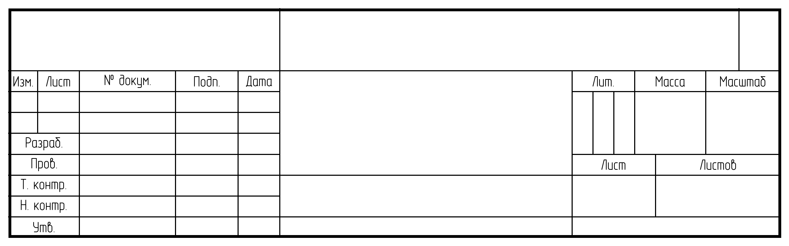

# Issue #63 — независимая нормативная приёмка формы 1 из Draft PR #59

**Дата:** 2026-11-13. **Контур ответственности:** ESKD, **не** PAINT. **Статус:** `BLOCKED_FOR_FORMAL_PAPER_KD`. Авторский рендерер и данные PAINT **не изменялись**. Документ и [38 машиночитаемых правил](issue-63-form-one-matrix.json) — независимая доказательная экспертиза, а не сертификат КОМПАС/ЕСКД.

## 1. Источники, версия и честная граница визуальной проверки

- **Действующий первоисточник:** [Росстандарт, ГОСТ Р 2.104-2023](https://protect.gost.ru/gost/details/69d422a2-3c0e-4561-a521-0c99f9cf4417); в РФ применяется с **01.03.2024**. Проверено публичное издание **сентябрь 2024 с поправками**, [пункт Б.1, обязательное приложение Б, форма 1, PDF с. 15 (0-based P14)](https://files.stroyinf.ru/Data/816/81679.pdf#page=15). Графический оригинал открыт как **изображение PDF**, а не только text extraction.
- **Точные нормы:** п. **4.2** бумажный/электронный режим; пп. **5.1** и **Б.1** форма первого графического листа; п. **5.2** основные и тонкие линии по ГОСТ 2.303; п. **5.3** дополнительные организационные графы; п. **5.6** условная электронная льгота без рамки/доп. граф; п. **5.7, табл.1, графы 1–35** — значения и правила заполнения; п. **5.8** формат даты; **Б.5** только книжная ориентация А4. Заданная высота шрифта проверялась с учётом ГОСТ **2.304-81** и текущего профиля Type A.
- **PR #59:** [Draft PR](https://github.com/Tridgi/gost-schematic/pull/59), обзор файлов `src/gost_schematic/rendering/form_one.py` (**Git blob `9025fefd18ec9e50118d7353f5b2565eb064b5c4`**) и `formatted_sheet.py`; **pin SHA ревью: `c42f7b617942c8a0b1cae45e432ef12cede7f876`**. PAINT продолжает собственные коммиты: анализ **не** претендует на оценку будущих SHA.
- **Созданный 1:1 образец:** независимый свежий запуск CLI в изолированной копии PR #59 при SHA `a4a1d574abe2e48bed7b4c350ffed5ea41073449`. На SHA-ревью `c42f7b...` сам файл `form_one.py` имеет **тот же exact Git blob SHA**, т.е. результаты относятся к той же геометрии и работе с полями. Экспортированы A4, A3 landscape/portrait, `form-one-title-closeup.svg`; manifest подтвердил 6 УГО, **16** актуальных проводников и 3 узла. Ещё более поздние правки примера/CI не переназначают автоматически геометрию этой конкретной версии.
- **Метрический PNG-контроль:** SVG 1:1 `width=189 mm`, `height=59 mm`, `viewBox=18 235 189 59`; внутри штамп `[20,237,205,292] mm`. Растеризован независимо по координатам SVG и реальному шрифту в **300 DPI**, PNG **2232×697 px** с DPI-метаданными. Это **300-DPI модель оттиска**, а не свидетельство реальной печати на бумаге. Не путать экранный `zoom 100%` с физическим размером: для проверки на бумаге выводить **без fit-to-page / с физическим 100%**.
- **Источник шрифта:** внешний OpenGost Type A Regular, `SHA256=f77d96f832b7c902d42fc391fddf15b622c1eadeb263dd31b926888d72e0773a`. **Шрифт не копировался в репозиторий и не прикладывается к отчёту.** PNG SHA256 `1afcbefda34508bd46a2f6d9e0c9f878f034726a26649b27a2c12da9486c64f0`; SVG SHA256 `c2abc1ae9f5afd466b1714d0271185cc5c087f0c996712ee4f0998ccccf9edfa`.

### Независимая иллюстрация выведенного штампа — 1:1, 300 DPI

**Визуальная экспертиза:** буквенные метки **существенно более читаемые**, чем прежняя уменьшенная подпись, без столкновений в **реально реализованных** 15 ячейках. Но на иллюстрации **не хватает** всех служебных и дополнительных граф формы Б.1. Оригинальный PDF **содержит масштабные разрывы (зигзаги)** в размерном рисунке, поэтому **бессмысленно выдавать простое pixel-overlay скана на произвольный SVG за эталон 1:1**. Сверка возможна по подписанным размерам, графам/границам, отдельно подтверждённому управляемому вектору КОМПАС и физической печати. Это остаётся **BLOCKED**.

## 2. Реальные измерения вывода PR #59

| Параметр | Измерено в свежем SVG | Оценка |
|---|---:|---|
| Лист A4 | **210×297 мм** | **PASS** по формату |
| A4 внутренняя рамка | `(20,5)..(205,292)` мм | **PASS**; поля 20/5/5/5 |
| Основная надпись | `(20,237)..(205,292)` мм = **185×55** | **PASS** |
| A3 landscape | **420×297**, титул `(230,237)..(415,292)` мм | **PASS** |
| A3 portrait | **297×420**, титул `(107,360)..(292,415)` мм | **PASS** |
| Отступ и вывод источника | перенос только `translate`, `data-scale=1:1` | **PASS**, не доказательство печати |
| Граница контура / линии таблицы | `0.7/0.25` мм | **PASS** факт двух толщин; полный допуск §5.2 **BLOCKED** |
| Число внутренних grid-`line` | **25** + 1 внешний `rect` | **PASS** как факт, **FAIL** для полной Б.1 |
| Главные x-деления | 7/10/23/15/10/110/10 = **185** | **PASS** |
| Должность (10) | ширина **17 мм**, 5 строк по **5 мм** | **PASS** |
| «Лит.» | **5+5+5 мм** при x=135–150 | **PASS** |
| «Масса» / «Масштаб» | **17/18 мм** | **PASS** |
| «Лист» / «Листов» | **20/30 мм** | **PASS** |
| Подписи | **15** названий; реальная `h(Н)=2.5 mm`; `font-size(em)=3.914 mm` | **PASS** для подтверждённых полей |
| Ink-vs-line, 15 полей | минимальная сторона свободной области **0.879 мм**; защитный padding **0.4 мм** | **PASS** в SVG при точном шрифте |
| Сценарий h=3.5 мм на всех заголовках | **`TITLE_FIELD_OVERFLOW: developed`** | **PASS** для fail-closed, не уменьшает шрифт |
| Длинное значение для `developed` | **`TITLE_FIELD_OVERFLOW`** | **PASS** для fail-closed |
| Фактическая графа (11) — фамилия | **нет отдельного ключа** для должностных строк | **FAIL**, семантика полей не полная |
| Фактическая графа (12) — подпись | **нет отдельного ключа** | **FAIL**, не путать с допустимым отсутствием выдуманной подписи |
| Фактическая графа (13) — дата | **нет отдельного ключа** | **FAIL**, интерфейс не поддерживает полноценное заполнение |

**Точный фрагмент 1:1 SVG:** A4 `form-one-title-closeup.svg` содержит **15** `<text>`, подписи `Разраб.`, `Пров.`, `Т. контр.`, `Н. контр.`, `Утв.`, `Изм.`, `Лист`, `№ докум.`, `Подп.`, `Дата`, `Лит.`, `Масса`, `Масштаб`, `Лист`, `Листов`. Визуальное сравнение при 300 DPI: подписи в рамках своих клеток, **нормативный комплект заголовков всё равно не полон**.

## 3. Нормативная матрица PASS / FAIL / BLOCKED — первоисточник против реализации

Полная versioned-матрица [**38 отдельных проверок с source/observation/status**](issue-63-form-one-matrix.json): **24 PASS / 6 FAIL / 8 BLOCKED**, включая лист, штамп, метрику шрифта, отрицательные сценарии, архивный C3 и электросвязи. Ниже критерии, **которые препятствуют формальному принятию**:

| ID | Статус | Графа/пункт ГОСТ | Наблюдение и конкретное действие |
|---|---|---|---|
| **F63-22** | **FAIL** | **Б.1, (30)** | Пунктирная вспомогательная область в оригинале отсутствует в текущих 25 grid-line (все plain solid); **внести отдельную геометрию (30) по контролируемому оригиналу**, не объединять с (2) |
| **F63-23** | **FAIL** | **Б.1, (33)** | В реальном captioned SVG нет **«Зона»**; отдельно позиционировать подпись и линию зоны, не подменять графой «Изм.» |
| **F63-24** | **FAIL** | **Б.1, (35)** | Нет **«Вер.»**; текущая правая 10-мм вертикальная область выделена линией, но должной подписи/ячеечной модели нет |
| **F63-25** | **FAIL** | **Б.1, (31)/(32)** | Нет подписи **«Копировал»** и **«Формат»**; их нижний служебный участок не реализован как отдельные управляемые графы |
| **F63-26** | **FAIL (MAJOR)** | **п. 5.7, табл. 1, (10)/(11)** | `title_values={"developed":"Иванов"}` записывает «Иванов» **в графу (10), x=0..17 мм**, тем самым вытесняя **«Разраб.»**; фамилия должна быть в **(11)**. **Разделить фиксированную должность и вводимые сведения о человеке.** Проверено с реальным шрифтом |
| **F63-27** | **FAIL (MAJOR)** | **п. 5.7, табл. 1, (11)/(12)/(13)** | Нет отдельных входов/ключей на фамилию, подпись, дату в строках. Пустые реквизиты в **демонстрации** — правильно; **отсутствие корректной модели для их заполнения** — неполнота. Ввести отдельные геометрические роли без вымышленных данных |
| **F63-28** | **BLOCKED** | **Б.1, графа (9)** | `organization = x135..185, y50..55 мм` необходимо размерно перепроверить относительно (31)/(32); **не объявлять этот bbox нормативным без полного эталона** |
| **F63-29** | **BLOCKED** | **Б.1, (2)/(30)** | `designation=x65..175,y0..15` потенциально перекрывает размерный вспомогательный пояс (30); нужны раздельные ячейки и сверка с оригиналом, а не «автоматически заполнить верхние 15 мм» |
| **F63-30** | **BLOCKED** | **Б.1, пп. 5.3/5.6, дополнительные (19)–(29), (34)** | Дополнительные графы и их применимость на бумаге/в электронном КД не подтверждены. Показать **условия**, прежде чем назначать их обязательными в каждом профиле |
| **F63-31** | **BLOCKED** | **п. 5.2, ГОСТ 2.303** | `stroke-width` в SVG ещё не доказывает ширину/типы линий на бумажном отпечатке |
| **F63-32** | **BLOCKED** | **ГОСТ 2.304-81** | Файл шрифта **не встроен** в SVG. При fallback меняются размеры букв, 0.879-мм запас может исчезнуть |
| **F63-33** | **BLOCKED** | **Б.1, приложение Б — исходная графика** | Рисунок ГОСТ с разрывами **не может служить прямым пиксельным шаблоном масштаба 1:1**; нужна размерная 1:1 КОМПАС-геометрия и независимый бумажный отпечаток |
| **F63-34/38** | **BLOCKED** | **п. 5.7, таблица 1** | Не указывать реальные документальные реквизиты без их источника, но нужен корректный путь заполнения и утверждённый организационный профиль |

**Нельзя записывать как дефект:** отсутствие **выдуманных** фамилий, подписей, литеры, даты, обозначения в пустом DRAFT-штампе; отказ от auto-shrink в ячейках высотой 5 мм; отсутствие рамки в `--mode clean` и условные электронные исключения пп. 4.2/5.6. **Условная обязательность** граф ≠ обязательное заполнение фиктивными сведениями.

## 4. Регрессия Issue #35 / #44 и перенос C3 после PR #62

Осмотрено на **актуальной `integration/stage0-12`** после объединения [PR #62](https://github.com/Tridgi/gost-schematic/pull/62), а не по историческому README PAINT:

| Источник истины | C3 origin / физические контакты | Электрические отрезки | Статус |
|---|---|---:|---|
| **Исторический Issue #35** `tests/fixtures/electrical-cycle3/end-to-end-clean.svg` + `end-to-end-diagnostics.json` | **(100,75)**, (91,75)/(109,75) мм | **18** | **PASS: сохранить как архив** |
| **Текущий Issue #44 / PR #62** `tests/fixtures/electrical-layout44/end-to-end-clean.svg` + live `authored_specimen()` | **(100,80)**, (91,80)/(109,80) мм | **16** | **PASS: новое текущее размещение** |
| **test_standards_issue_35.py** | 18 архивных SVG-проводников проверяются по **собственному старому JSON**, а не путем сравнения с live graph из 16 сегментов | 18 archive | **PASS, логика исторической регрессии сохранена** |
| **PR #59, новая редакция** | Тест/CLI обновлены на 16, `C3` сравнивается как archive-vs-current | 16 live | **PASS** только на зафиксированных актуальных версиях примеров; дальнейшие PAINT-коммиты оценивать отдельно |

**Особо:** ранний PR #59 по SHA `be8b161...` действительно содержал `assert len(wires)==18` для live и устаревший текст об «ещё не принятом» переносе C3; эти строки **нельзя переносить в новый тест** после PR #62. При последующей независимой проверке `c42f7b...` тест содержит `==16`, скрипт сравнения использует frozen archive и current. **Не изменять** архивные файлы из-за текущих данных и не выдавать старый снимок за актуальный.

## 5. Что передать PAINT / координатору

**P0 до нормативного approval:**
1. Добавить *отдельные* нормативные графы (11)/(12)/(13) (все пять строк подписантов) и статические должности (10). Не позволять `title_values['developed']` уничтожать заголовок «Разраб.» и писать фамилию в столбец должности.
2. Вынести вспомогательную графу (30), пунктирные линии, подписи «Зона», «Вер.», «Копировал», «Формат» из placeholder-полосы; подтвердить координаты прямо по размерным линиям обязательной Б.1 и правилам заполнения табл. 1.
3. Разнести `source-backed dimensions`, `conditional additional fields`, `editorial print typography`; дополнительный Б.1 накладной блок нельзя объявлять обязательным для **всех** электронных документов без проверки §§4.2/5.6.
4. Сохранить **h=2.5 мм Type A**, уже проверенное реальные ink bounds (min inset 0.879мм), и явные ошибки `TITLE_FIELD_OVERFLOW` при длинной подписи / заголовках h3.5; **не уменьшать** шрифт до 1–1.6мм ради прохождения тестов.
5. Оформить чистые SVG/PNG 1:1 на **новом SHA**, доказательство одинакового font SHA + корректного печатного масштаба; провести независимую 1:1 сверку не путём растягивания PDF-скана с разрывами, а по координатам и ревьюере КОМПАС.
6. Держать freeze старой 18-wire фикстуры #35 и current 16-wire после PR62; новые live assertions — только 16. Не вносить нормативный test-only обход в production routing.
7. Оставить **DRAFT/BLOCKED**. Ни одна успешная автоматическая проверка не заменяет 1:1 человеческую приёмку всей формы и её обязательных граф.

**Граница PR ESKD:** в собственной ветке только нормативный пакет, матрица, тесты и независимый PNG. **Ни одного изменения генераторов, электрических моделей, API или PAINT-ветки.** Это **заявка на исправления владельцу rendering**, не автоматическое исправление `src/gost_schematic/rendering/`.
