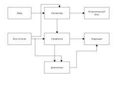

# Issue #69 — нормативный профиль электрической структурной схемы Э1

**Дата проверки:** 2026-11-13 · **Статус:** `DRAFT`, требует отдельной инженерной и визуальной приёмки · **Ответственный:** ESKD · **Заказчики требований:** ELEKTRIK и YGO 2 · **Изоляция:** только `docs/standards/` и независимые тесты. Ни генераторы, ни общие API, ни каталожные паспорта УГО не изменяются.

[42 машиночитаемые карточки](issue-69-e1-rule-cards.json) · [Семантический эталон 7 блоков и 9 связей](issue-69-e1-example.json) · [Векторная иллюстрация без электрической нетлисты](evidence/issue69-seven-block-e1.svg).

## 1. Первичные источники и область действия

| Источник | Точно проверенная часть | Что регулирует |
| --- | --- | --- |
| [ГОСТ 2.702-2011, **Действует**](https://protect.gost.ru/gost/details/d9c1c334-2a90-45cb-ac00-c31da92d706b); [PDF, стр. 6](https://www.elec.ru/files/2019/03/25/gost_2.702-2011.pdf#page=6) | **§§5.1.1–5.1.5**, §4.3–4.5 | Непосредственно **электрическая структурная схема**: что показать, прямоугольник или УГО, имя, направление процесса, таблица номеров |
| [ГОСТ 2.701-2008, **Действует**](https://protect.gost.ru/gost/details/87f1f382-a055-48b7-ae80-f359ff5e1f4e); [публичная копия издания](https://rosgosts.ru/file/gost/01/100/gost_2.701-2008.pdf) | §§4.2–4.4, 5.3.1–5.3.6, 5.4.1–5.4.4, **5.5.1–5.5.4**, 5.6.2–5.6.3 | Код **Э1**, общая графическая компоновка, реальные зазоры, штрихи, связи и текст |
| [ГОСТ 2.304-81, **Действует**](https://protect.gost.ru/gost/details/2acb3258-c28c-4e4a-b7ac-208043f2d95e); [PDF](https://www.it-mda.ru/standards/docs/GOST/GOST_2.304-81.pdf#page=3) | **§§1.1–1.5, 2.1, табл. 1–2** | Чертёжный шрифт: **h — фактическая высота прописной**, для типа A `d=h/14` |
| [ГОСТ 2.721-74, **Действует**](https://protect.gost.ru/gost/details/c153a749-14f2-49e8-8544-acc32ab35406); [PDF](https://ohranatruda.ru/upload/iblock/328/4294852095.pdf) | **§2, табл. 1**; **§7, табл. 6в поз. 5/6** | Стрелки для **конкретного вида потока** и правила **именно электрических линий связи**. Безусловно приравнивать к ним связи логических функций Э1 нельзя |
| ГОСТ 2.710-81 | Отсылка в **ГОСТ 2.702-2011, §4.3** | При необходимости буквенно-цифровых обозначений проверять отдельно. Конкретные правила `ID` в этом PR не сертифицируются |

**Иллюстративный источник, не норматив:** [Habr, «Схемы электрические. Типы схем», 12.05.2019](https://habr.com/ru/articles/451158/). Статья удобна для объяснения различий Э1/Э2/Э3, но **не** устанавливает положение портов, размер блока, тип стрелки или точность линий. **Ни одной нормативной карточки на ней не основано.**

**Нормативный конфликт, которого нет:** ГОСТ 2.702 §5.1.2 разрешает для Э1 **обычные прямоугольники или УГО**. В ГОСТ 2.701 §§5.3.5–5.3.6 также описан особый **контур устройства/функциональной группы** со сплошной или штрихпунктирной линией по условию наличия самостоятельной принципиальной схемы. Это не означает, что **каждый прямоугольник Э1 обязан быть штрихпунктирным**. Редактор должен различать семантику `functional_rectangle`, `device_contour` и `catalog_ugo`.

## 2. Норма, рекомендация, пользовательский выбор

| Тема | Обязательная норма | Рекомендация/допущение | **Не задано стандартом** |
| --- | --- | --- | --- |
| Состав Э1 | Все **основные** функциональные части и основные связи (§5.1.1) | — | Фиксированное количество блоков |
| Внешний вид | **Прямоугольник или УГО** (§5.1.2) | УГО выбирается по применимому каталогу | Любые конкретные `W×H` стандартного функционального прямоугольника |
| Имя блока | **Обязательно для каждого прямоугольника** (§5.1.4) | Размещать имя **внутри** прямоугольника, добавлять тип/документ | Обязательное геометрическое центрирование каждой подписи |
| Много блоков | Разрешено заменить названия номерами **при наличии таблицы** (§5.1.5) | Номера справа/над блоком, сверху вниз слева направо | Порог `N`, после которого требуется нумерация |
| Компоновка | Обеспечить наглядную последовательность взаимодействий (§5.1.3) | Стрелки для направления процесса (§5.1.3) | Обязательный порядок слева направо, запрет обратной связи |
| Место подключения | Связи должны соответствовать основным взаимодействиям | **Проектно** — середина стороны для одиночного подключения | **Центр стороны, сторона входа/выхода, фиксированное число портов, шаг между портами** |
| Линии | Толщина **0.2–1.0 мм** (§5.5.1); преимущественно H/V, минимум изломов/пересечений (§5.5.2) | **0.3–0.4 мм** рекомендуется; короткая диагональ в особом случае допускается | Универсальная ширина стрелки или обязательный диаметр точки логического fork |
| Просветы | Соседние параллельные линии связи **≥3.0 мм по чернильным краям**, отдельные **УГО ≥2.0 мм**, между линиями одного **УГО ≥1.0 мм** (§5.3.4) | Для функциональных прямоугольников использовать как минимум 2 мм и более с учётом текста | «Текст–рамка обязан иметь ровно 1 мм», «центр портов через ровно 5 мм» |
| Шрифт | ГОСТ 2.304: физическая высота прописных букв `h`; для типа A `d=h/14` | **h=3.5 мм**, ink-centering и padding **2 мм** — проектный профиль | Отождествление `CSS font-size:3.5` с подтверждённым `h=3.5 мм` |

**Точность терминов:** «обязательно», «рекомендуется», «допускается» и «не установлено» имеют разные юридико-технические значения. Нельзя переводить «рекомендуется стрелка» в CI-ошибку нормативного уровня или «центр порта» — в стандарт ЕСКД.

## 3. Редакторские правила для входов/выходов

Для прямоугольника с левым верхним углом `(x,y)`, шириной `w`, высотой `h` **предлагаемый UX для единственного порта** (не размеры ГОСТ):

| Сторона | Редакторская точка `(x_port,y_port)` |
| --- | --- |
| Левая | `(x, y + h/2)` |
| Правая | `(x + w, y + h/2)` |
| Верхняя | `(x + w/2, y)` |
| Нижняя | `(x + w/2, y + h)` |

**Для `n` подключений на одной стороне** предлагается вычислять отдельные координаты `s_i=i·L/(n+1)`, `i=1…n`, где `L` — полезная длина стороны, исключающая области закруглений/углы/внутренние надписи в конкретном редакторском профиле. При `n=1` получается центр. Если между параллельно идущими линиями не удаётся обеспечить **3 мм реального просвета**, нужно увеличить габарит блока, изменить сторону либо построить отдельный breakout/маршрут. Не уменьшать обязательный просвет ради сохранения «идеальных» долей. Равномерное деление, порядок и защищённая угловая зона **произвольные политики редактора**, а не §5.1.

При толщине `t1`, `t2` минимальное расстояние между **осевыми** линиями, когда эти отрезки действительно соседние и параллельные: `3.0 + (t1+t2)/2` мм. При `t1=t2=0.35` это **3.35 мм**. Отдельные порты на одной стороне сами по себе не обязаны иметь именно межосевой интервал 3.35 мм: нормативный 3-мм просвет относится к **параллельным линиям взаимосвязи**, а не к абстрактной сетке пользовательских «портов». Пример B2 имеет два разных вывода на правой стороне в `(64,75)` и `(64,80)` мм, осевой интервал **5 мм** и просвет **4.65 мм** между параллельными выходящими отрезками — **PASS**.

**Вход слева/сверху, выход справа/снизу — только удобство чтения.** В отдельных устройствах сигнал может входить справа, направление может быть двусторонним, присутствовать обратная связь. Сторона не должна менять смысл `input/output` автоматически.

### Правильная семантика пересечений и ответвлений

На Э1 **линия взаимосвязи** описывает функциональный/информационный процесс, а не непременно медный провод. Нельзя автоматически применять валидатор физической цепи из Э3, оперирующий `PinRef`, электрическими сетями и пайкой.

- **Разветвление:** один явно авторизованный функциональный поток B2 → B4 и B2 → B7, общий узел `P1=(72,80)` мм, два назначения. Проектный кружок `r=0.5 мм` помогает читать fork, но **его число не устанавливается ГОСТ 2.702 §5.1**.
- **Пересечение без связи:** независимые X `(84,27)` мм (**L1 × L8**) и `(112,115)` мм (**L6 × L9**); пересечение геометрии **не** создаёт ни «логическую ветвь», ни физическую электрическую точку.
- **ГОСТ 2.721 табл. 6в поз. 5/6** устанавливает графику **электрических линий**: X без соединения и T-ответвления; **одно T-ответвление электрической связи допустимо даже без точки** (примечание 2). Прямое безусловное перенесение этих графических правил на логический граф Э1 — **не доказано**. Если же конкретная линия Э1 утверждается как **электрическая** по смыслу, применять выбранный стандартный вид по его собственной области действия.
- **Стрелки процесса** (§5.1.3 ГОСТ 2.702) — не **межлистовые стрелки** (§5.5.3 ГОСТ 2.701, при переходе между листами обрыв без стрелки с адресом); и не стрелки **внутрилистового разрыва** (§5.5.4, отдельное условие).

## 4. Иллюстративная Э1: семь прямоугольников / девять функциональных связей

**Ни размер листа, ни физическая печать, ни ГОСТ-шрифт у примера не утверждены.** Доступный SVG — методический **DRAFT**, а не полноценная конструкторская схема: корень `240×175 мм` не оформлен как А4/А3, названия показаны обычным `sans-serif` без измеренной физической cap-height и никакой нормированной основной надписи нет. Перед передачей генератору инженер YGO 2 должен заменить показательный шрифт на измеренный ГОСТ type A и выполнить отдельную рамку/штамп по выбранному формату, а не обманом объявить SVG «готовым ЕСКД».

| Блок | Функция и геометрия в примере, мм | Связи |
| --- | --- | --- |
| B1 | Ввод, `(16,15)`, 48×24 | L1 → B3 |
| B2 | Блок питания, `(16,68)`, 48×24 | L2 → B4, L8 → B3, **L9 → B7 через P1** |
| B3 | Контроллер, `(91,15)`, 52×24 | L1/L8 вход, L3 → B5, L5 → B4 |
| B4 | Управление, `(91,68)`, 52×24 | L2/L5 вход, L4 → B6, L6 → B7 |
| B5 | Исполнительный блок, `(173,15)`, 51×24 | L3 вход |
| B6 | Индикация, `(173,68)`, 51×24 | L4/L7 вход |
| B7 | Диагностика, `(91,127)`, 52×24 | L6/L9 вход, L7 → B6 |

Отрезки L1–L9 заданы точным графом в [JSON](issue-69-e1-example.json) и в SVG `polyline data-link-id`. Ровно две X-позиции **не** перечислены как узлы; P1, напротив, есть в `explicit_logical_branches` и помечен отдельно. Можно тестировать **сохранение смысла**, не выводя смысл из факта пересечения штрихов.

## 5. Критерии приёмки — ELEKTRIK (направленные связи)

| ID | Сценарий **PASS** | Отрицательный сценарий / ожидаемый вердикт |
| --- | --- | --- |
| E1-02/03 | Все ключевые блоки и все существенные связи перечислены | Пропущен исполнительный блок → **нормативный FAIL**, §5.1.1 |
| E1-10/11 | Порядок взаимодействий читаем; направление обозначено стрелками | Нет стрелок при сохранении ясности → **warning / recommendation**, не нормативный FAIL |
| E1-13/15 | Один порт в центре стороны **по выбранному editor profile** | Смещённый порт не должен считаться нарушением ГОСТ; ошибочно блокировать — **FAIL редакторской реализации** |
| E1-14/16 | У B2 два разных выхода справа с интервалом 5 мм | Две независимые связи из одного координатного порта с неопределённым fan-out → **project FAIL**, не пункт про единственный порт ГОСТ |
| E1-18/19 | H/V, минимально нужные изгибы, короткий оправданный наклон при необходимости | «Любая диагональ запрещена ГОСТ» — ложное правило; хаотичный маршрут без причины — **quality FAIL** |
| E1-20/21/25 | `t=0.35мм`, параллельные тракты на расстоянии 5мм дают `4.65мм` ink gap | `t=0.15мм` → **нормативный FAIL**; `dy=3.0мм, t=0.35` → `2.65мм` реального просвета, **нормативный FAIL** |
| E1-34 | L1×L8 в (84,27) и L6×L9 в (112,115) не связаны | X ошибочно превращено в электрический junction / объединённые `PinRef` → **semantic FAIL** |
| E1-35 | Переход L2→L9 через **явный** P1; два получателя | Любое случайное T становится ветвью, даже при несовпадении логических link IDs → **semantic FAIL** |
| E1-36 | Допустим цикл обратной связи с понятными стрелками | Цикл отклонён как «ГОСТ запрещает» → **ложное правило** |
| E1-31/32/33 | Внутри листа разрыв имеет ссылку; между листами — адрес без маркера перехода | Смешаны три различных значения стрелки → **семантический FAIL** |

**Для ELEKTRIK:** обязательно различать `FunctionalBlockID`, `ProcessLinkID`, `BranchID` как **проектную концепцию данных**, а не менять текущие публичные API. Никаких программных миграций `ExternalWireGraph`/`Circuit` из Э3 без решения координатора. Э1 — уровень структуры, физическая электрическая связность подтверждается уже схемой Э3/монтажными документами.

## 6. Критерии приёмки — YGO 2 (блок и текст)

| ID | Сценарий **PASS** | Отрицательный сценарий / ожидаемый вердикт |
| --- | --- | --- |
| E1-04/05 | Прямоугольник `functional_rectangle` с полным названием | Без имени и без корректной таблицы номеров → **нормативный FAIL** |
| E1-06/28 | Имя внутри блока, реальные `ink_bounds` центрированы | Слишком длинный текст выходит за границу: **editor FAIL**, без auto-shrink ниже выбранного `h` |
| E1-08/09 | Много блоков, у каждой цифры есть строка таблицы | Просто номера без таблицы → **нормативный FAIL** |
| E1-22/38 | Реальное стандартное УГО со своим источником и проверенным размером, толщина совпадает с линиями взаимосвязи | УГО произвольной геометрии отмечено `APPROVED`, без нормы или легенды → **normative BLOCKED** |
| E1-23/42 | `functional_rectangle` и особый `device_contour` различаются | Все 7 прямоугольников автоматически штрихпунктирные из-за §5.3.6 → **ложная интерпретация** |
| E1-24/26 | Отдельные УГО имеют ≥2 мм просвет, внутренние UGO-линии ≥1 мм | Просвет менее нормы → **нормативный FAIL для соответствующего объекта** |
| E1-27 | Реальное прописное `h=3.5мм` измерено по `Н`, стиль Type A подтверждён SHA | Объявлено `font-size:3.5px/mm` без метрики `h` → **BLOCKED** |
| E1-29/30/40 | Краткие подписи; текст линии ориентирован вдоль H; не пересекает рамку/связь | Бессмысленное сокращение/перекрытие → **fail** по соответствующей норме или проектной читабельности |
| E1-39 | Произвольный размер функционального блока, достаточно места для надписи | Вшить 48×24 как «единственный ГОСТ-размер» → **ложная нормативная карточка** |

**Условия вывода из DRAFT:** независимый сравнительный SVG/PNG с реальным шрифтом и проверкой `h`; учёт выбранных УГО, реальных gap/stroke, блоковых подписей, X/T; подтверждение охвата **всех основных функциональных частей** инженером изделия; отдельная рамка/основная надпись по действующему профилю и согласованные реквизиты. **Зелёный CI не эквивалентен сертификации чертежа.**

## 7. Обязательные границы задач других workstreams

**ELEKTRIK:** маршрутизировать именно *функциональные связи*, а не перемычки электрических nets. Выводы/port offsets/editorial defaults должны быть конфигурируемыми и не подменять физические контакты. Случайное X не порождает связь. Для нескольких выходов нужны непересекающиеся секции, явный тип fan-out, учёт просвета по видимым штрихам.

**YGO 2:** сначала разнести `functional_rectangle` (разрешённая форма Э1) и физический стандартный `SymbolDefinition` (паспорт, нормы размера, 8 преобразований). Не пополнять каталог Э3 42 новыми УГО: **42 карточки — нормативные правила, не графические элементы**. Реальный ГОСТ type A и векторная высота обязательны для утверждаемого листа, образцовый `sans-serif` — только illustration.

**PAINT / оформление листа:** при экспорте Э1 на бумажный лист отдельным шагом проверить актуальную форму 1 и применимость электронных исключений, которые не зависят от логического графа; не считать лист `240×175` полноценным А4. Исходный иллюстративный SVG не затрагивает генератор.

**Статус:** `DRAFT_NOT_FORMALLY_APPROVED`, **0 новых УГО APPROVED**, никакого merge в `integration/stage0-12` без координатора. Habr — **не норма**.
