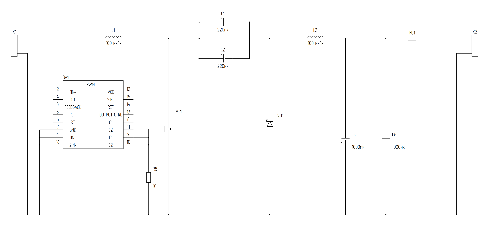

# TL494CN — первая общая схема из настоящих рендереров

**Предварительный результат (DRAFT).** Это не окончательная схема Э3. Из 23 позиций исходного чертежа построены и объединены **13**: X1, X2, DA1, VT1, VD1, L1, L2, C1, C2, C5, C6, FU1, R8.

В отличие от первоначальной ручной SVG-версии:

1. 16-выводная TL494CN отрисована **исходным PAINT #93** (SHA `79ddb2ae57efd9ea621d64914a324988b343061d`) в едином листе с другими элементами.
2. Графика резистора, MOSFET, диода Шоттки, дросселей, предохранителя и четырёх конденсаторов порождена штатными `SymbolDefinition` из каталога и `render_external_wire_sheet`.
3. C1, C2, C5, C6 исправлены с `capacitor.electrolytic` с прямоугольными обкладками на **`capacitor.polarized`**, ближе к фотографии источника; плюсовой и минусовой физические выводы контролируются по `PinRef`.
4. DA1.9 и DA1.10 соединены с VT1.G и R8, DA1.7/1/16 подключены к COMMON. Проводники вычислены от настоящих точек подключения двух рендереров. Графика PAINT заменяет только физически идентичный временный листовой адаптер. Нет имитации УГО отдельными ручными SVG линиями.
5. Шрифт `OpenGost Type A TT` измерен исходным `inspect_type_a_font` (высота Н = 3,5 мм), и эти параметры используются как для IC, так и для всей листовой графики.
6. `validate_external_wires`: **0 ошибок**. `validate_circuit`: **0 ошибок**. `layout_sheet.valid`: **true**. В графе **35 точных ортогональных сегментов**. Генератор теперь отказывает в экспорте при ошибках топологии или раскладки.

[Чистая PNG](tl494_connected_output/TL494_connected_clean.png) · [Чистая SVG](tl494_connected_output/TL494_connected_clean.svg) · [Диагностика с реальными зелёными квадратами PNG](tl494_connected_output/TL494_connected_diagnostic.png) · [Manifest](tl494_connected_output/TL494_connected_manifest.json) · [Исходный Python](tl494_connected_native.py) · [CI](../.github/workflows/tl494-connected-native.yml).

## Что всё ещё отсутствует

Из 23 позиций не включены C3, C4, C7, R1, R2, R3, R4, R5, R6 и R7. Двенадцать реальных графических элементов вместе с DA1 здесь не имитируют весь ШИМ-преобразователь. Пока к общей силовой схеме подключены только DA1.1, DA1.7, DA1.9, DA1.10 и DA1.16. Остальные выводы DA1 не имеют трассировки.

**Нет оснований включать устройство по этой схеме**, несмотря на 0 ошибок ERC: тест проверяет внутреннюю согласованность переданного неполного графа, а не работоспособность всей электроники. Выводы VCC=12 и REF=14 ещё не подключены, и реальные обратная связь/генератор/soft-start ещё не включены. Функции `a` и `b` из фотографии должны быть дополнительно сверены.

## Транзистор VT1

`transistor.mosfet_n_enh` — существующий элемент каталога по ГОСТ 2.730-73. Он **разработан, но ещё DRAFT**. Его слабый вид нельзя исправлять несанкционированной ручной заменой: улучшение требует нормативного сравнения, обновления УГО и регрессионного тестирования.

## Источники

- Оригинальная фотография Э3 и спецификация пользователя.
- [GOST Schematic Engine](https://github.com/Tridgi/gost-schematic), базовая `integration/stage0-12`.
- Черновые PAINT #93 и ELEKTRIK #97 — не объединены в `integration`.
