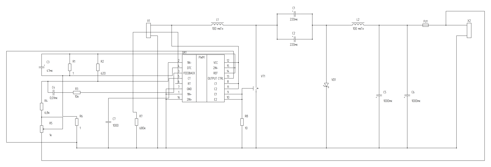

# TL494CN — сравнение исходной фотографии с нативной схемой

**Источник:** две фотографии пользователя: принципиальная схема 640×290 px и перечень элементов. Формат: **DRAFT**, неутверждённая Э3. Это реально исполняемый GOST Schematic Engine с фактической графикой каталога и PAINT #93, а не ручное SVG-подражание.

## Проверенная привязка к оригиналу

| Особенность на фото | Исправленное представление | Проверка |
|---|---|---|
| L1 и L2 имеют сплошную линию магнитопровода над полуокружностями | `inductor.ferromagnetic`, 100 мкГн | Рендерит настоящий каталог ГОСТ 2.723-68 |
| Транзистор VT1 с G, D, S, стрелкой в канале и соединительной точкой | `transistor.mosfet_n_enh` с отдельной DRAFT-точкой на нижнем участке проводника | Три физические PinRef; форма и точка требуют нормативного PAINT-QA |
| VD1 показывает треугольник вниз и катодную Шоттки-черту **снизу** | Поворот исходного `diode.schottky` на 90°; физический A сверху, K снизу | Точки Net A/K поменяны вместе с геометрией |
| Литера `a` от положительного входа X1.1 | Физический Net `INPUT_POS` = X1.1, L1.1, DA1.12, DA1.8, DA1.11 | Провод от X1.1 к реальным точкам DA1, без подмены PinRef |
| DA1 имеет 16 выводов, задействованных в исходном фото | Все `1..16` привязаны к 15 именованным Net | Проверяется ровно 16 уникальных DA1 PinRef |
| C1/C2 + слева, C5/C6 + на общей нижней шине | `capacitor.polarized` вместо неправильной первоначальной формы | Физическая полярность соответствует исходной фотографии |
| Микросхема вертикально подписана PWM | PAINT #93 `function_rotation=90`; неизменные физические точки | Тип А OpenGost, матричная геометрия PAINT |
| R1/R2/C3; C4/R3; R4/R5; R6/C7/R7 и R8 | Все 23 позиции перенесены из оригинальной спецификации | Нет дубликатов физических PinRef |

## Фактически запущенные проверки GitHub Actions

- `23` ComponentInstance, `15` Circuit.Net, `16` физических выводов TL494, `95` WireSegment.
- `validate_external_wires`: **0 ошибок**.
- `validate_circuit`: **0 ошибок**.
- `render_external_wire_sheet`: **layout.valid=true**.
- `OpenGost Type A TT`, фактическая высота прописной Н = 3.5 мм.
- Запуск в строгом режиме `--strict`, SVG/PNG получены без форсированного обхода ошибок.
- Исходники нативной генерации: [tl494_full_photo_sheet.py](tl494_full_photo_sheet.py).
- [Чистый PNG 300 DPI](tl494_full_photo_output/TL494_full_photo_clean.png), [чистый SVG](tl494_full_photo_output/TL494_full_photo_clean.svg), [диагностический PNG](tl494_full_photo_output/TL494_full_photo_diagnostic.png), [JSON manifest](tl494_full_photo_output/TL494_full_photo_manifest.json).

## Что остаётся недостатком

1. Нынешний полный вариант соединяет `b` длинным временным проводом по периметру листа, **в отличие от фотографии**, где `b` — маркировка продолжения выходной цепи. Готовится отдельное представление через **реальный** `NetContinuationProject` (#90). Не выдавать прямоугольную петлю за достоверный след оригинала.
2. Через лист проходят многочисленные неподключённые перекрестия. Движок различает Net по семантике, но ещё не оформляет автоматически графические «мостики» на всех пересечениях. Требуется улучшить визуальное качество.
3. 0 ошибок ERC означает только согласованность переданного графа, **а не правильность или пригодность электрического изделия**. В особенности направление VD1 перенесено из снимка, а не доказано как правильное для инвертирующего преобразователя.
4. По перечню `R7=680 кОм`, `C7=1 нФ`, при этом текст упоминает генератор ≈100 кГц. Оценка `1/(R×C)` ≈1,47 кГц; требуется уточнить технический источник. Без этого нельзя обещать необходимую частоту.
5. УГО VT1 и диода, магнитопроводов, полярных конденсаторов остаются DRAFT до инженерного нормативного сравнения. Документ не получил статус APPROVED по ЕСКД.

[CI: TL494 full photo native](../.github/workflows/tl494-full-photo-sheet.yml).

**Изоляция:** все результаты в ветке `reference/tl494-native-rework-20261114`; `main` и `integration/stage0-12` не объединялись с экспериментами.
