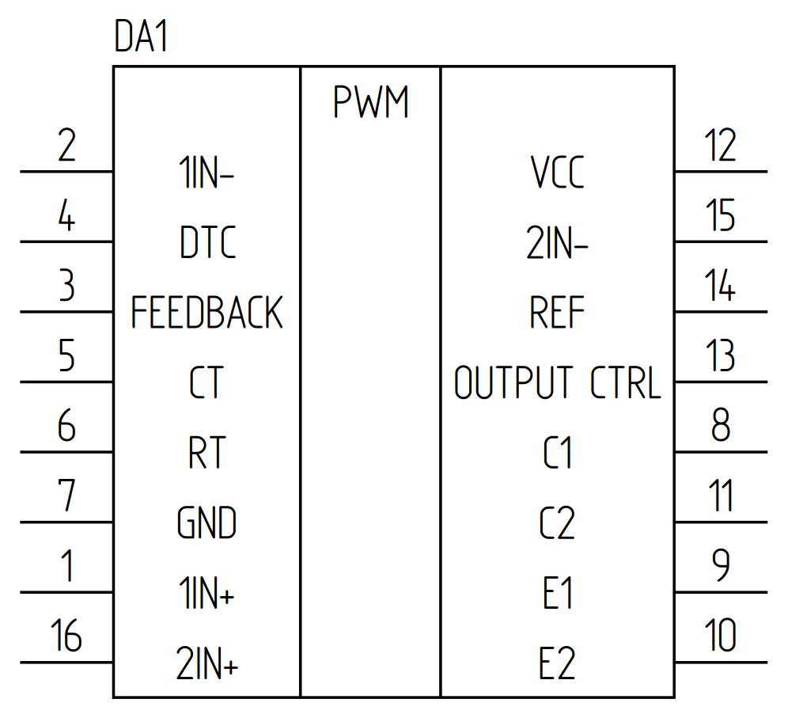
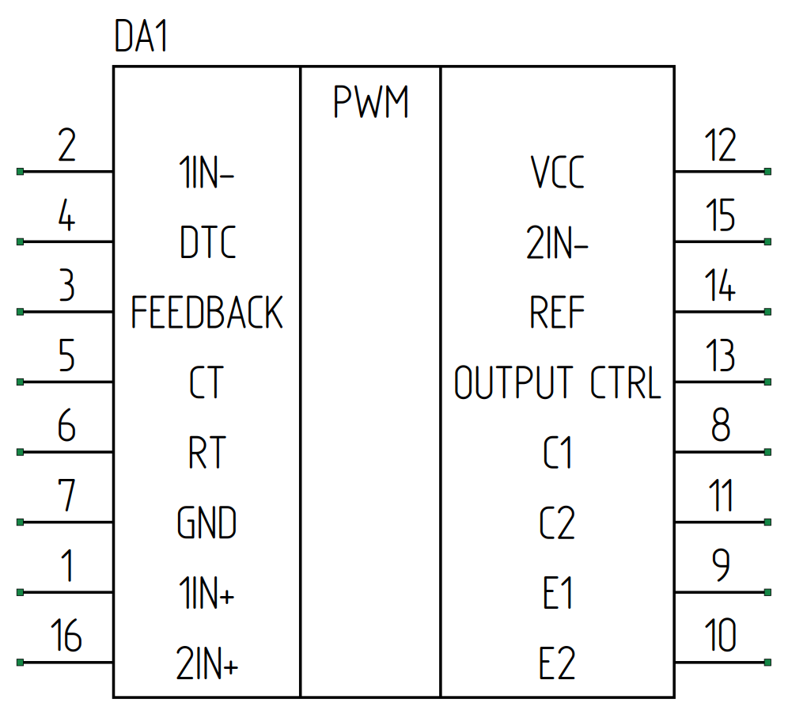

# TL494CN — исправленный инженерный эталон на настоящем GOST Schematic Engine

**НЕ ПУТАТЬ с прежней ручной SVG-перерисовкой.** Эта ветка отделена от `integration/stage0-12`. Действующие инженерные классы использованы непосредственно; опытные компоненты и PR не объединялись в `integration`.

## Результат 1 — настоящая нативная силовая часть

- [Чистая схема PNG](tl494_native_output/TL494_native_power_clean.png)
- [Чистая схема SVG](tl494_native_output/TL494_native_power_clean.svg)
- [Диагностический PNG](tl494_native_output/TL494_native_power_diagnostic.png)
- [Диагностический SVG](tl494_native_output/TL494_native_power_diagnostic.svg)
- [Manifest проверок](tl494_native_output/TL494_native_power_manifest.json)
- [Реальный воспроизводимый Python API](tl494_native_rework.py)

Доказано реальным запуском GitHub Actions: **11 физических компонентов, 6 Net, 26 WireSegment, 0 ошибок сети, 0 ошибок ERC, валидный layout, шрифт OpenGost Type A TT с измеренной высотой 3,500 мм**. УГО остаются DRAFT; ERC-проверка без ошибок не равна нормативному утверждению.

Результат **частичный**: отсутствует сам TL494 и цепь управления ключом VT1. Изображение нельзя использовать как законченную рабочую схему.

## Результат 2 — настоящая 16-выводная TL494 от PAINT #93

- [TL494 обычный PWM, PNG](tl494_ic_output/TL494CN_PWM_angle_0_clean.png)
- [TL494 вертикальный PWM, PNG](tl494_ic_output/TL494CN_PWM_angle_90_clean.png)
- [TL494 с настоящими зелёными точками 16 PinRef, PNG](tl494_ic_output/TL494CN_PWM_angle_0_diagnostic.png)
- [Все SVG и диагностический manifest](tl494_ic_output/)
- [Код PAINT-адаптера](tl494_ic_paint_reference.py)

В отдельном GitHub Actions запуске использовался точный SHA чернового PAINT PR #93 — `79ddb2ae57efd9ea621d64914a324988b343061d`. **Без слияния PR**. Два варианта наклона названия `PWM` имеют те же 16 физических PinRef и одинаковые координаты выводов. OpenGost Type A TT откалиброван, точки рисуются самим PAINT при разрешённом редакторском оверлее.

## Результат 3 — все 23 элемента в типизированной модели

- [Circuit/Net/PinRef, 23 элемента, 15 сетей, 62 PinRef](tl494_model_output/TL494_full_typed_netlist.json)
- [Воспроизводимая Python-модель](tl494_full_native_model.py)
- [Лог CI](tl494_model_output/model_build_log.txt)

Действительно прогнаны `CatalogResolver`, `ComponentInstance`, `PartDefinition`, `SymbolDefinition`, `Circuit`, `Net`, `PinRef` и `validate_circuit`. Не найдено дублирования физических контактов, валидация ERC — 0 ошибок. Однако есть 23 предупреждения `UNAPPROVED_SYMBOL` и 5 предупреждений `POLARITY_UNVERIFIABLE`.

**Ограничение:** пока нет одного нативно скомпонованного, визуально и электрически проверенного чертежа с 23 компонентами. Топология контроля привязана по исходному фото в виде DRAFT и ещё не превращена в проложенный `ExternalWireGraph`. Поэтому это **не итоговый Э3 и не утверждённый PDF**.

## Обнаруженные фактические проблемы

1. Предыдущий SVG рисовался вручную. Не использовать как эталон качества движка.
2. В исходном фото есть буквенные продолжения `a` (вход) и `b` (выход); они объединены в новой DRAFT-модели, но требуют ревизии.
3. По таблице `R7=680 кОм` и `C7=1 нФ`; по формуле TL494 для частоты около `1/(R×C)` получается ~1,47 кГц, не заявленные около 100 кГц. Значение нельзя менять без подтверждения исходника.
4. Пока не закрыты штатный 16-выводной IC в `integration`, многоузловая трассировка, утверждение каталога и round-trip `.gseproj`.

**Исходники и CI:** [.github/workflows/tl494-native-rework.yml](../.github/workflows/tl494-native-rework.yml), [.github/workflows/tl494-ic-paint-proof.yml](../.github/workflows/tl494-ic-paint-proof.yml), [.github/workflows/tl494-full-typed-netlist.yml](../.github/workflows/tl494-full-typed-netlist.yml).

Ни один из этих экспериментов не объединён в `main` или `integration/stage0-12`.

## Независимая проверка исходного кода

[7 проверок pytest](tl494_qa_output/pytest.txt): **7 passed**. [Ruff](tl494_qa_output/ruff.txt): **All checks passed** (F/E4/E7/E9). Отдельно проверены точные координаты G/D/S, направленность диода, полярность C5/C6, 23 элемента и отсутствие повторных PinRef.
