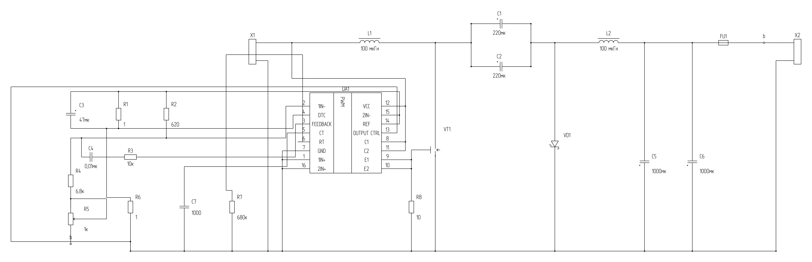

# TL494CN — актуальная реконструкция по двум исходным фотографиям

**Актуальный обзор:** это **DRAFT-файлы**, а не утверждённая по ЕСКД документация и не подтверждение работы преобразователя. Визуально и электрически восстановлены все 23 позиции с исходной фотографии, применены физические PinRef, штатные УГО каталога и экспериментальный PAINT #93.

## Файлы для просмотра

- [Чистая схема PNG, 300 DPI](tl494_named_truth_output/TL494_named_photo_clean.png)
- [Чистая схема SVG](tl494_named_truth_output/TL494_named_photo_clean.svg)
- [Диагностическая PNG: физические выводы DA1](tl494_named_truth_output/TL494_named_photo_diagnostic.png)
- [Диагностическая SVG](tl494_named_truth_output/TL494_named_photo_diagnostic.svg)
- [Manifest — точная ведомость проблем и проверок](tl494_named_truth_output/TL494_named_photo_manifest.json)
- [Журнал фактического исполнения](tl494_named_truth_output/build_log.txt)
- [Исходный код](tl494_named_photo_sheet.py)
- [CI сборки](../.github/workflows/tl494-named-photo-sheet.yml)

## Сравнение с исходной фотографией (640×290)

| Схема-оригинал | Исправление движка | Статус |
| --- | --- | --- |
| L1/L2 со сплошным сердечником сверху | `inductor.ferromagnetic`, линия магнитопровода над дугами, 100 мкГн | Совпадает по типу |
| VT1: G слева, D сверху, S снизу; внутренняя стрелка и точка на соединении | Истинные G/D/S и экспериментальная точка по source-photo; каталог MOSFET сохраняет свои геометрические примитивы | DRAFT, нужна нормативная сверка |
| VD1 на вертикальной линии с катодной Шоттки-чертой снизу | `diode.schottky` повернут на 90°, физический **A сверху, K снизу**, та же ориентация, что на фото | Источник перенесён буквально; электрическая целесообразность не подтверждена |
| Литера **a** от X1.1 к питанию и выходным коллекторам TL494 | Один `INPUT_POS` физически связывает X1.1, L1.1, DA1.12, DA1.8, DA1.11 | Проверено по PinRef и геометрии проводов |
| В фото задействованы выводы DA1 **1–16** | Все 16 физических выводов распределены по именованным Net и привязаны к проводам | Проверено точно |
| Буквенное продолжение **b** рядом с X2.1 и R5.2 | **NetContinuationProject v2**, одна сеть `OUTPUT_NEG`, две подписанные невещные точки, НЕТ длинной петли по периметру | Типизированная семантика #90 принята |
| C1/C2 плюс слева; C5/C6 плюс к 0 В снизу | `capacitor.polarized`, без прежних прямоугольных обкладок | Проверено по реальным номерам |
| C3/R1/R6 soft start, C4/R3 RC feedback, R2/R4/R5 делитель, C7/R7 генератор | Все 10 отсутствовавших раньше элементов размещены на том же листе и получили собственные физические связи | Проверено по Net и графу |
| Надпись PWM вдоль оси микросхемы | Только текст повернут на 90°, физические 16 выводов НЕ поворачиваются | Реальный PAINT PR #93 |

## Независимо зафиксированные испытания

`GitHub Actions` запустил:
- **23 физических ComponentInstance**, **15 Circuit.Net**, **16 TL494 PinRef**, **91 WireSegment**.
- `validate_circuit`: **0 ERROR**.
- `layout_sheet`: **valid=true**; шрифт `OpenGost Type A TT` проверяется измерением настоящих глифов.
- `NetContinuationProject v2` и `validate_net_continuations` с адресами настоящих физических контактов X2.1/R5.2: **0 ошибок**.
- `validate_external_wires`: **0 неожиданных ошибок**, 2 **ожидаемых** диагностических сообщения именно из-за именованной сети `b`: `WIRE_NET_DISCONNECTED` и `WIRE_DANGLING_END`. Это не подавление без доказательств — причиной их исключения является принятая типизированная `ContinuationPair` из Issue #90.
- **Строгий экспорт (--strict)** выполнен, сохранены SVG и PNG.

## Недостатки, которые нельзя скрывать

1. Макет ещё не повторяет компоновку исходной схемы 1:1: расстояния и маршруты выбраны заново, из-за чего есть длинные участки и перекрестия без точек подключения. Улучшение качества автоматической трассировки остаётся задачей.
2. Стрелка и внутренний узел MOSFET реализованы как **экспериментальное дополнение к DRAFT-УГО**, без изменений общесистемного каталога и без статуса нормативного APPROVED.
3. Диод скопирован с направлением по исходнику, но для реального инвертирующего Ćuk это направление следует перепроверить расчётом и моделированием. Корректность электрической работы схемы **не подтверждена**.
4. Перечень элементов задаёт **R7=680 кОм и C7=1 нФ**, но примечание обещает частоту ≈100 кГц. `1/(RC)` даёт примерно **1,47 кГц**. Не исправлять номиналы без подтверждения оригинала.
5. Не все графические формы, номиналы и разнесение подписей независимо сертифицированы по ГОСТ/ЕСКД. Исходное фото низкого разрешения ограничивает уверенность в отдельных деталях.

Оригинальный устаревший ручной SVG остаётся только как отрицательный эксперимент. **Принят только этот исполняемый референс как DRAFT-проверка**, не как готовый производственный чертёж.

**Изоляция:** `reference/tl494-native-rework-20261114`, `main` и `integration/stage0-12` не менялись.
